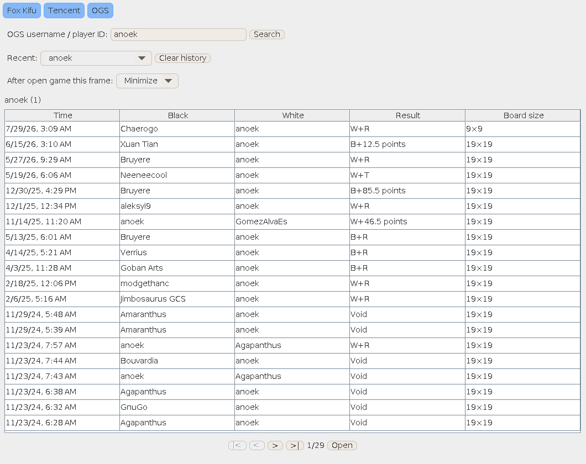

# OGS game records

Click **OGS** beside the Fox and Tencent buttons in the main toolbar, or choose **OGS game records** from the Sync menu. Function search also finds this action.

1. Enter an OGS username or numeric player ID and press **Search** or Enter.
2. Browse completed public games. The table shows the date, Black, White, result, and board size. Use the paging controls for older games.
3. Double-click a game, press Enter on the selected row, or click **Open**.
4. Choose whether the browser minimizes, closes, or stays open after a successful import. Recent searches are retained for the current browser window.

The downloaded record uses the same loading and analysis flow as Fox and Tencent. No engine is needed to browse or open a game; an engine is needed for analysis. Failed downloads leave the current board intact. Closing the browser cancels its pending request and ignores late responses.

**File → Open online link** also accepts an OGS game URL, such as `https://online-go.com/game/68984609`, or an OGS SGF download URL.

This feature accesses public completed games without signing into OGS. It does not follow live games.

## Preview

The production browser controls populated from public OGS history, with the shared toolbar buttons shown above them:

