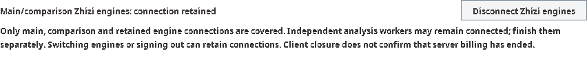
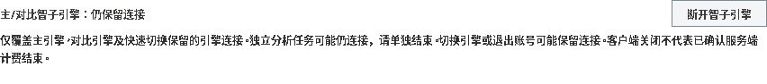

# Scoped Zhizi disconnect: local QA, 2026-10-27

## Scope and identities

This change adds an explicit **Disconnect Zhizi engines** action and persistent
connection status independent of the selected provider or signed-in account. It
covers main, comparison and fast-switch-retained engine connections, including
selected engines detached from the engine catalog. It preserves unrelated local
and custom engines and does not change the global fast-switch policy.

Independent analysis workers are **not** covered by this action and may remain
connected; finish those tasks separately. Active exclusive tasks or pending
manager transitions reject disconnection instead of reporting success. Retired
UI requests and transport callbacks cannot restart their canceled connection.
Client closure is not evidence that server billing has ended.

- Base: `6e935abee3c1d61f2fbade7fce62459739febb12`.
- Tested source commit: `a91d4da366283efb8bc490ac5a52dc60552c2b46`.
- Tested source tree: `91c156ca029ddcddb8c10ca36abe896de971306f`.
- Environment: isolated Linux cloud workspace, Eclipse Temurin JDK 21.0.13,
  Maven 3.9.11. Tests used local fixtures, not paid Zhizi service sessions.

The source was tested before its local commit was created. The full-gate summary
therefore records the base commit plus working-tree changes; the frozen source
tree above identifies the tested content. This documentation and the copied
screenshots are a subsequent docs-only change, not a new source test run.

## Verification results and limits

| Check | Observed result |
| --- | --- |
| Focused lifecycle, transport, dialog and rendering regressions | **323 passed**, no failures, errors or skips |
| Full portable Java gate | **Not green:** 5,790 tests, 6 failures, 1 error, 135 skips |
| Clean-base reproduction of affected environment tests | Same 6 layout failures: 4 in `SuggestionTableScrollPaneTest`, 2 in `WinrateGraphFrameTest` |
| Command-launch test with writable isolated `user.home` | **13 passed**, no failures, errors or skips |
| Packaging and shaded-artifact smoke checks | Package built; **4 smoke tests passed**, no failures, errors or skips |
| Formatting and repository checks | Passed: formatting, line endings, architecture budget, localization baseline, local Markdown links and diff check |

The full-gate error was `CommandLaunchHelperTest` attempting a temporary directory
under the read-only `/home/agent` home. The corrected-home focused run does not
turn the original full-gate failure into a pass. The six clean-base layout
failures remain disclosed; no production workaround or assertion weakening was
introduced to hide them. Conditional skips do not establish acceptance of the
skipped scenarios.

Coverage includes retained and detached selected connections, main/comparison
ownership, exclusive-task refusal, repeated disconnect, deferred activation
cancellation, replacement manager/catalog/command identities, late callbacks,
dialog dismissal, transport shutdown and localized control rendering.

No live billing-stop claim, paid-service test, native full-application UI
acceptance, independent-worker shutdown, release publication or cross-platform
acceptance is established by these local results. Hosted PR checks are a separate
gate and are not certified here.

## Headless control renders

These are credential-free raster renders of the production connection controls,
not screenshots of a native full application or an actual service connection.
The retained-connection state is a test fixture. Both images were inspected for
visible scope and billing warnings; the rendering test covers the shipped locale
variants at the minimum control width.

### English

### Simplified Chinese

